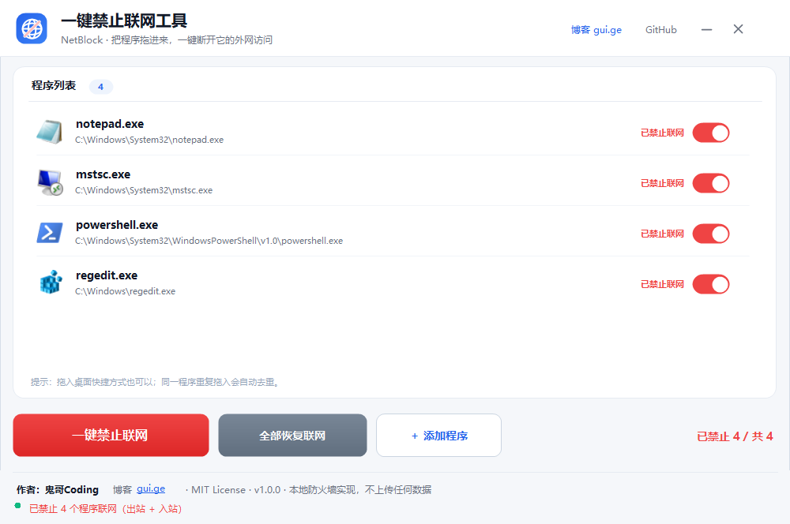

# NetBlock · 一键禁止联网工具

> 把任意 Windows 程序拖进来，一键切断它的外网访问；再点一下，原样恢复。
> 作者：**鬼哥Coding** · 博客：<https://gui.ge>


一个 90 KB 的单文件小工具，不写 hosts、不改程序文件、不装驱动、不联网、无遥测。
它做的事情只有一件：**给指定程序加 Windows 防火墙规则，拦住它的所有出入站流量**。

---

## 截图

**空状态（把图标拖进来即可）**


**已禁止联网（红色开关 = 该程序已断网）**



---

## 功能

| 功能 | 说明 |
|---|---|
| **拖放添加** | 拖 `.lnk` 桌面快捷方式、`.exe`、或整个文件夹（取其下的 EXE），自动解析真实路径 |
| **批量添加** | 支持一次拖入多个文件、多选「添加程序」对话框 |
| **独立开关** | 每行右侧一个开关，单独控制这个程序联网/断网，互不影响 |
| **一键禁止** | 给列表里所有程序一次性加规则（出站 + 入站，全端口） |
| **全部恢复** | 一次性删除本工具添加的全部规则，网络立刻恢复 |
| **自动去重** | 同一个程序重复拖入不会产生重复条目 |
| **状态自检** | 启动时读取系统真实规则，列表显示的「已禁止/可联网」不是猜的 |
| **程序图标** | 自动提取 EXE 图标，一眼认出是哪个程序 |
| **右键菜单** | 打开文件所在位置 / 从列表移除 |
| **托盘常驻** | 关到托盘不占地方，右键可直接「一键禁止 / 全部恢复」 |
| **快捷键** | `F5` 禁止 · `F9` 恢复 · `Delete` 移除选中 · `Esc` 退出 |
| **配置持久化** | 程序列表存在本地，下次打开自动载入 |
| **零系统侵入** | 只操作 `NetBlock_*` 前缀的防火墙规则，不碰你的其它规则 |

---

## 工作原理

Windows 防火墙支持「按程序」的规则，而不是只能按端口。NetBlock 就是用它：

```
netsh advfirewall firewall add rule name="NetBlock_OUT_<hash>" dir=out action=block program="<exe 路径>" enable=yes profile=any
netsh advfirewall firewall add rule name="NetBlock_IN_<hash>"  dir=in  action=block program="<exe 路径>" enable=yes profile=any
```

- `<hash>` = 程序完整路径的 MD5 前 10 位，保证同名不同路径的程序互不干扰
- `dir=out` + `dir=in`：出站和入站都拦，全端口，不只是 80/443
- `profile=any`：域 / 专用 / 公用三种网络配置下都生效
- 恢复 = 按同样的名字删掉规则，干净利落

**它不会做的事情**（这也是它安全的原因）：
- ❌ 不改 `hosts` 文件
- ❌ 不改程序文件、不注入、不挂钩子
- ❌ 不装服务、不装驱动、不写注册表启动项
- ❌ 不联网、不上传任何数据（可以断网使用）
- ❌ 不动别人的防火墙规则

**注意**：程序级规则只对「这个 exe 自己发起的连接」生效。如果某个程序是通过系统进程（如 `svchost.exe`）、浏览器或另一个它拉起来的子进程联网，需要把那个进程也加进列表。

---

## 使用方法

### 1. 运行

双击 `NetBlock.exe`。首次会弹 UAC —— 改防火墙必须管理员权限，点「是」。

### 2. 添加程序（三种方式任选）

- **拖进来**：把桌面图标 / exe / 文件夹直接拖到窗口里
- **点「＋ 添加程序」**：文件对话框，可多选
- **命令行预载**：

```powershell
NetBlock.exe --add "C:\Program Files\SomeApp\app.exe" --add "D:\Tools\tool.exe"
```

### 3. 禁止 / 恢复

- 想全部禁止 → 点红色 **「一键禁止联网」**（或按 `F5`）
- 想单独控制某个 → 点那一行右边的开关
- 想全部恢复 → 点 **「全部恢复联网」**（或按 `F9`），确认即可

列表里红色的 **「已禁止联网」** 就是当前真实状态（来自系统规则，不是本地记忆）。

### 4. 移除条目

选中某行按 `Delete`，或右键 → 「从列表移除」。移除时会顺带删掉它的规则。

---

## 命令行为参数

| 参数 | 作用 |
|---|---|
| `--add <路径>` | 启动时把程序加进列表，可重复多次 |
| `--selftest <日志路径>` | 自检：在临时目录伪造两个程序 → 加规则 → 校验 → 删规则 → 清空，退出码 0 为通过 |

---

## 数据与清理

| 位置 | 内容 |
|---|---|
| `C:\ProgramData\NetBlock\programs.txt` | 程序列表（一行一个路径） |
| `NetBlock_OUT_*` / `NetBlock_IN_*` | 防火墙规则（在「Windows Defender 防火墙 → 高级设置」里可见） |

**彻底卸载**：
1. 打开 NetBlock → 点「全部恢复联网」（清掉所有规则）
2. 删掉 `NetBlock.exe`
3. 删掉 `C:\ProgramData\NetBlock\` 目录

不留服务、不留注册表项、不留后台进程。

---

## 常见问题

**Q：点了禁止，程序还能上网？**
A：三个可能：① 它是由别的进程代它联网的（常见于 Electron/浏览器内核程序，主进程才是联网方）；② 它有多个 exe（启动器 + 主体 + 更新器），要把每个都加进来；③ 系统里装着第三方安全软件接管了防火墙，规则不生效。

**Q：会不会把我自己的防火墙规则搞乱？**
A：不会。NetBlock 只增删自己 `NetBlock_` 前缀的规则，「全部恢复」也只按这个前缀删。

**Q：需要装 .NET 吗？**
A：不需要。Windows 10 / 11 自带 .NET Framework 4.8，直接跑。

**Q：能在公司域环境用吗？**
A：规则加了 `profile=any`，域网络下同样生效；但域策略如果禁止本地防火墙规则，则会被组策略覆盖。

**Q：为什么图标是断网的地球？**
A：一眼看出这软件干什么的。

---

## 自己编译

```powershell
# 1. 生成图标（可选，仓库里已带 src\app.ico）
python build\make_icon.py

# 2. 编译（用系统自带的 csc，不需要装 SDK）
$csc = "$env:WINDIR\Microsoft.NET\Framework64\v4.0.30319\csc.exe"
& $csc /nologo /target:winexe /platform:anycpu /optimize+ /codepage:65001 `
  /out:dist\NetBlock.exe /win32icon:src\app.ico /win32manifest:src\app.manifest `
  /r:System.dll /r:System.Core.dll /r:System.Drawing.dll /r:System.Windows.Forms.dll `
  src\NetBlock.cs
```

或直接跑 `.\build.ps1`。产物：`dist\NetBlock.exe`，约 90 KB。

---

## 目录结构

```
netblock/
├─ src/
│  ├─ NetBlock.cs        全部源码（UI + 引擎 + 自检，单文件）
│  ├─ app.manifest       requireAdministrator + DPI aware
│  └─ app.ico            程序图标
├─ build/
│  ├─ make_icon.py       图标生成脚本
│  └─ shot.ps1           截图/自动化测试脚本
├─ docs/
│  ├─ screenshot-empty.png
│  └─ screenshot-blocked.png
├─ dist/
│  └─ NetBlock.exe       编译产物
├─ build.ps1             一键编译
└─ LICENSE
```

---

## 更新日志

### v1.0.0
- 首个版本：拖放添加、独立开关、一键禁止、全部恢复、托盘、快捷键、状态自检

---

## 作者

**鬼哥Coding** · 博客 <https://gui.ge>

如果这个工具帮到你，去博客点个赞就够了。

## License

MIT © 2026 鬼哥Coding
